# GDI-CSI Retrofit Architecture for Compression-Ignition Engines

[](https://github.com/arunroshan-as/GDI-CSI-Retrofit-Architecture-for-CI-Engines/actions/workflows/ci.yml)


**Gaseous Direct Injection with Compression- and Spark-assisted Ignition (GDI-CSI) for hydrogen + HERRSCHER Proprietary Fuel Blend (HPF) operation of existing diesel (CI) platforms - first target: heavy commercial vehicles.**

> **Status:** Research & development - simulation-based preliminary results. **Every number and plot in this repository is a model output or a stated assumption, not bench data.** See [`docs/ASSUMPTIONS_AND_METHOD.md`](docs/ASSUMPTIONS_AND_METHOD.md).

## Continuation of

This repository continues the system-level work in
**[Hydrogen-IC-Engine-Retrofit-for-Heavy-Commercial-Vehicles](https://github.com/arunroshan-as/Hydrogen-IC-Engine-Retrofit-for-Heavy-Commercial-Vehicles)**,
which covers the overall retrofit concept and the **ECU / embedded control side** (CKP-synchronised STM32 control). Here the focus is the **GDI-CSI combustion system**: injection timing, spark strategy, lean-burn control and efficiency. The interface between the two is defined in [`docs/ECU_INTERFACE.md`](docs/ECU_INTERFACE.md).

## 1. Concept

An existing CI engine keeps its block, crank train, turbocharger and exhaust path. The **cylinder head is replaced** with a gaseous-direct-injection head and the fuel path is converted to a gaseous common rail:

| Subsystem | Donor CI engine | GDI-CSI retrofit |
|---|---|---|
| Fuel | Diesel | Hydrogen + HPF (gaseous) |
| Injection | Diesel common-rail (CRDi) injector | Gaseous direct injector (CRDi-type, H2 + HPF compatible) |
| Ignition | Compression only | **Compression + spark assistance (CSI)** with hydrogen-compatible iridium plug and coil |
| Head | Diesel head, CR 17.5:1 | Replacement GDI-CSI head, CR ~16:1 with quench geometry |
| Mixture | Diffusion burn, lambda ~1.5 | Lean stratified/late-injected, lambda 2.0 (full load) to ~6 (light load) |
| Control | Diesel ECU | Retrofit ECU, CKP + CAM synchronised injector and coil scheduling |

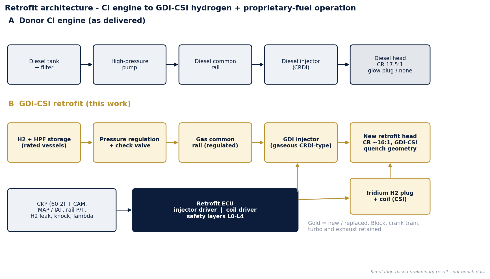
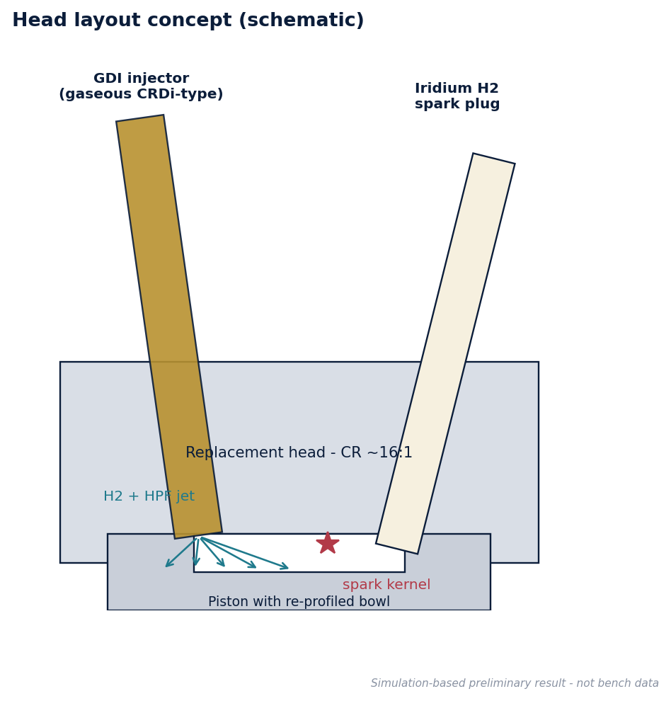

### Combustion sequence (4-stroke)

1. **1st stroke - intake:** unthrottled boosted air (lean).
2. **2nd stroke - compression:** the **gas injector fires late in compression**, between roughly 14 and 38 deg BTDC (start) and 9 to 17 deg BTDC (end), so injection completes just before the end of the 2nd stroke.
3. **End of compression / start of 3rd stroke:** the **spark follows injection** by ~5 deg (4 to 12 deg BTDC), igniting the mixture that has formed during compression; hot compressed charge plus spark gives fast, complete burn.
4. **3rd stroke - power / 4th - exhaust.**

Because the mixture is lean and mixing time is controlled by injection timing, peak flame temperature is limited, which reduces NOx; combustion is more complete than a diesel diffusion flame, which lowers CO, HC and soot.

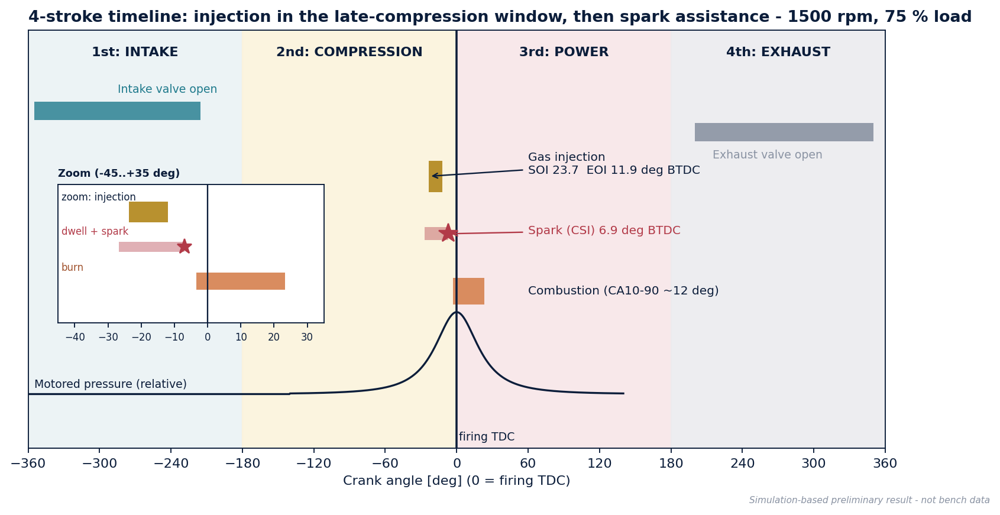

## 2. Headline results (model-based, preliminary)

Generic donor: 6-cylinder, 5.64 L HCV-class turbo-diesel (bore 102 mm x stroke 115 mm).

| Metric | Diesel baseline | GDI-CSI retrofit | Change |
|---|---|---|---|
| Peak torque | 560 Nm | 603 Nm @ 1400 rpm | +7.6 % (+10.3 % at 1000 rpm) |
| Rated power (2400 rpm) | 128 kW | 131 kW | +2.1 % |
| Peak BTE | 37.4 % | 45.1 % | +20.4 % rel. |
| Map-average efficiency gain | - | - | 19.5 % (range 15.3 to 21.5 %) |
| 9-mode cycle BTE | 33.7 % | 40.3 % | **+19.7 % rel.** (target band 17-22 %) |
| 9-mode cycle NOx | 6.57 g/kWh | 0.45 g/kWh | -93 % |

Honest caveats: full-load NOx (0.8-2.9 g/kWh in the model) is the weak point because lambda is lowest there; the cycle figure is dominated by lean part-load operation. These are targets for validation, not claims.

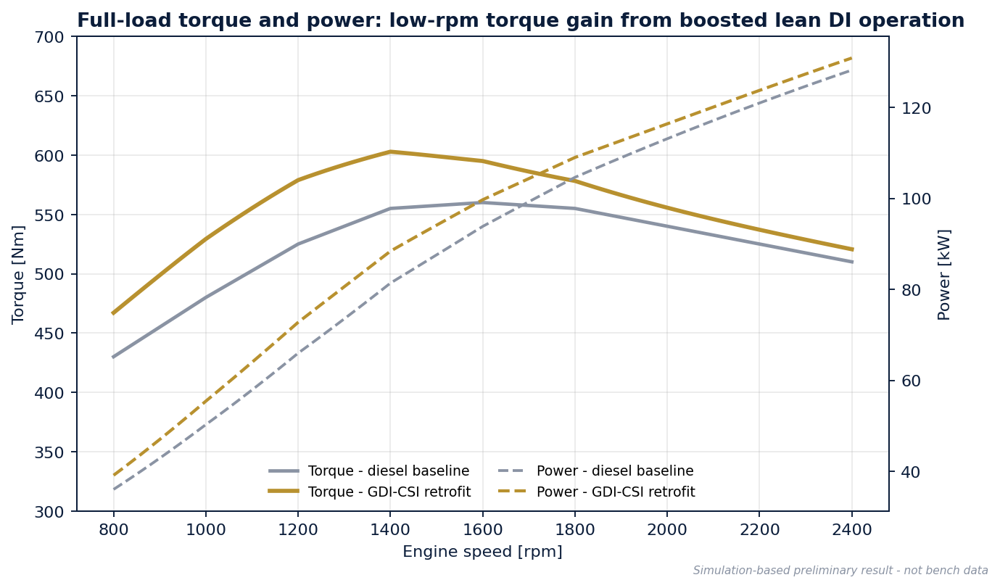
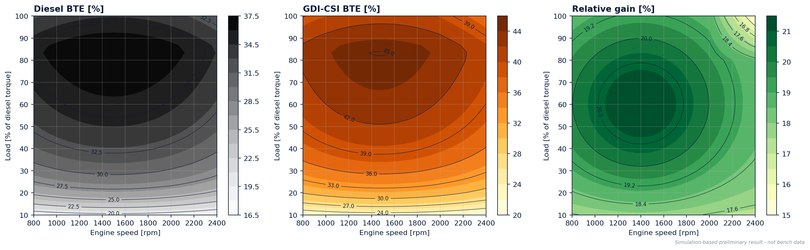
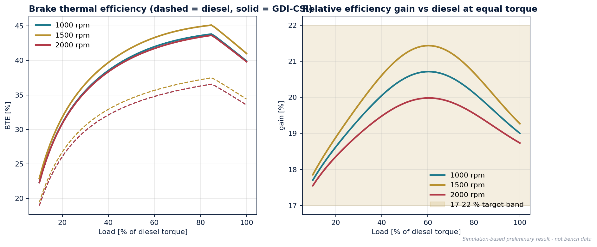

## 3. Injection and spark strategy

Reference calibration (excerpt - full grid in [`data/gdi_csi_calibration_map.csv`](data/gdi_csi_calibration_map.csv)):

| rpm | Load % | BMEP bar | λ | Rail bar | Fuel mg/cyc* | SOI °BTDC | EOI °BTDC | Inj. ms | Spark °BTDC | BTE diesel % | BTE GDI-CSI % | Gain % |
|---|---|---|---|---|---|---|---|---|---|---|---|---|
| 1000 | 25 | 2.7 | 3.76 | 69 | 6.2 | 15.6 | 11.9 | 0.62 | 6.9 | 28.2 | 33.6 | 19.0 |
| 1000 | 50 | 5.3 | 2.75 | 76 | 10.3 | 16.9 | 11.1 | 0.96 | 6.1 | 33.7 | 40.6 | 20.5 |
| 1000 | 100 | 10.7 | 2.02 | 91 | 21.0 | 19.1 | 9.6 | 1.58 | 4.6 | 33.5 | 39.9 | 19.0 |
| 1600 | 25 | 3.1 | 3.95 | 72 | 7.1 | 20.2 | 13.8 | 0.68 | 8.8 | 28.9 | 34.5 | 19.3 |
| 1600 | 50 | 6.2 | 2.89 | 80 | 11.7 | 22.8 | 13.0 | 1.02 | 8.0 | 34.5 | 41.7 | 21.1 |
| 1600 | 100 | 12.5 | 2.12 | 95 | 23.9 | 28.2 | 11.5 | 1.75 | 6.5 | 34.4 | 41.0 | 19.2 |
| 2200 | 25 | 2.9 | 4.14 | 76 | 7.0 | 24.1 | 15.6 | 0.64 | 10.6 | 27.5 | 32.6 | 18.4 |
| 2200 | 50 | 5.9 | 3.03 | 84 | 11.7 | 27.6 | 14.9 | 0.97 | 9.9 | 32.8 | 39.1 | 19.2 |
| 2200 | 100 | 11.7 | 2.22 | 99 | 23.9 | 35.4 | 13.4 | 1.67 | 8.4 | 32.7 | 38.3 | 17.0 |

\* hydrogen-equivalent energy basis. SOI/EOI are hydraulic (flow) timings; ECU command timings include injector opening/closing delays and are listed in the CSV.

Design rules used:

* **EOI = spark + 5 deg** so injection completes before the spark and the mixture has time to form.
* **SOI is solved**, not chosen: the required fuel mass is integrated backwards from EOI through the compressible orifice flow (choked / sub-critical) against the rising cylinder pressure.
* **Rail pressure** rises with load (60 to 100 bar envelope in this study) to keep injection duration short as cylinder back-pressure rises.
* **Spark advance** grows with speed and with leanness.
* **Lean-burn lambda** falls from ~6 at light load to ~2 at full load; intake restriction sets the floor on charge pressure at light load.

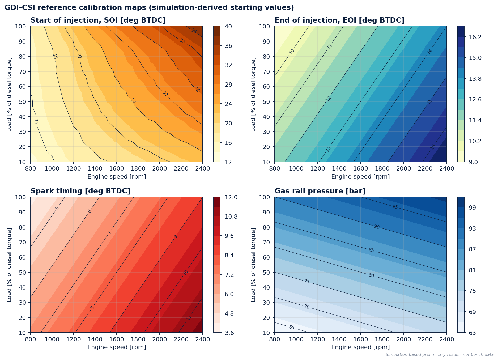
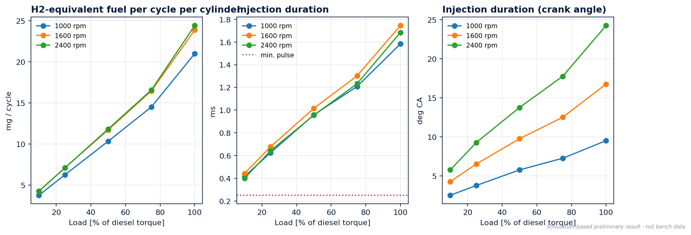
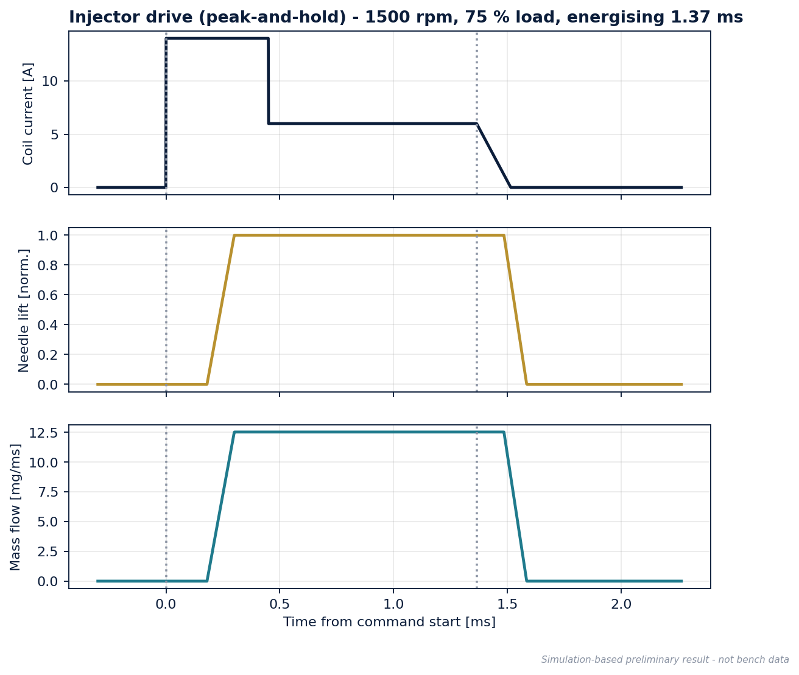
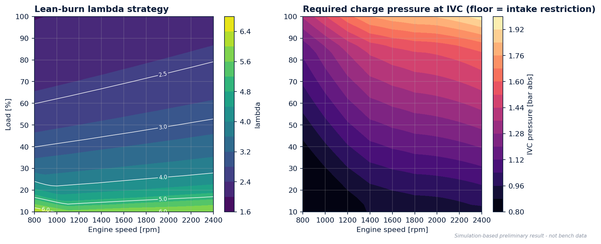

## 4. Combustion and emissions

Single-zone first-law model at 1400 rpm / full diesel torque: peak pressure 125 bar (GDI-CSI) vs 128 bar (diesel); maximum pressure-rise rate 7.2 vs 9.9 bar/deg.

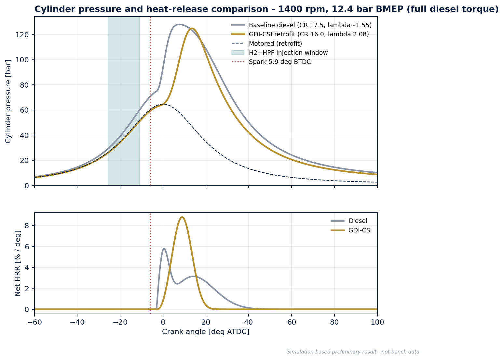
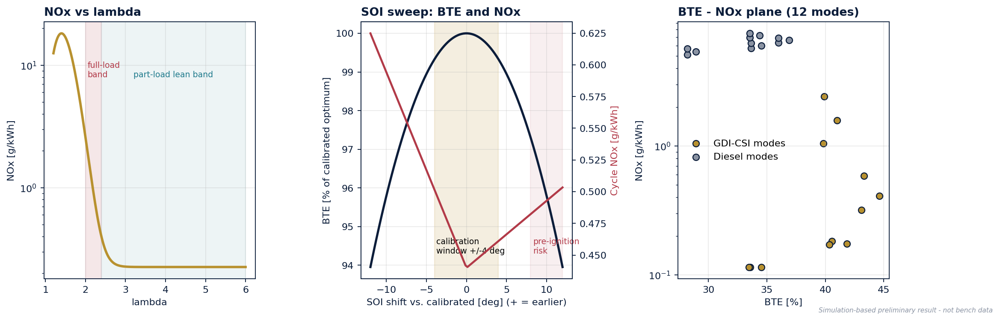
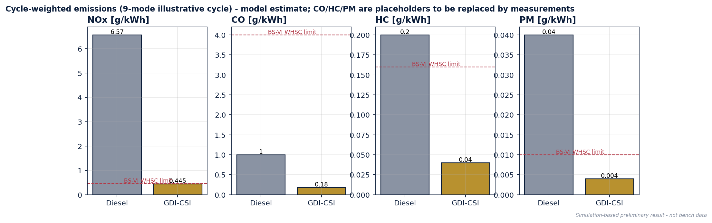
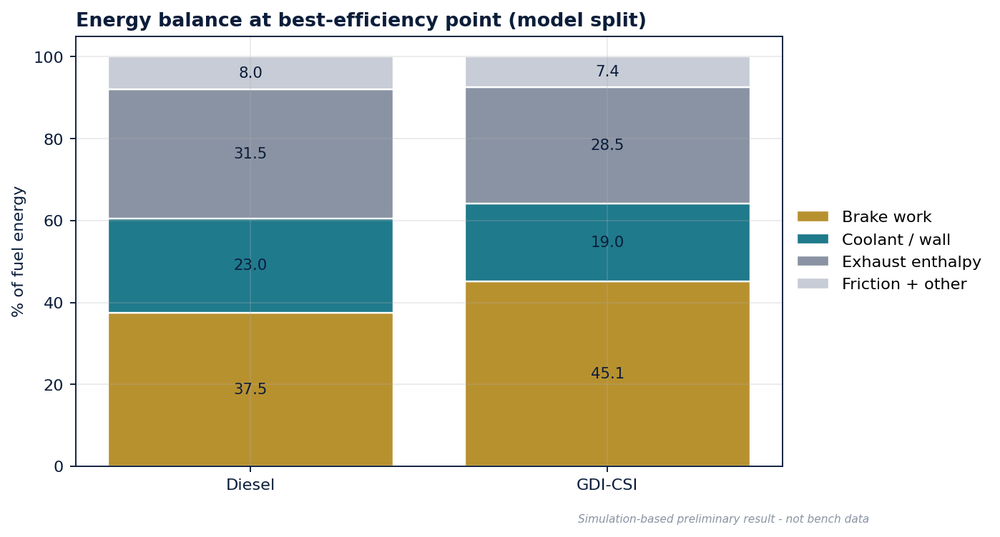

## 5. ECU integration and safety layers

The retrofit ECU synchronises to the crank (60-2 CKP wheel) and cam phase signal, then schedules injector and coil events from the maps above. See [`docs/ECU_INTERFACE.md`](docs/ECU_INTERFACE.md) and the parent repository for the embedded implementation.

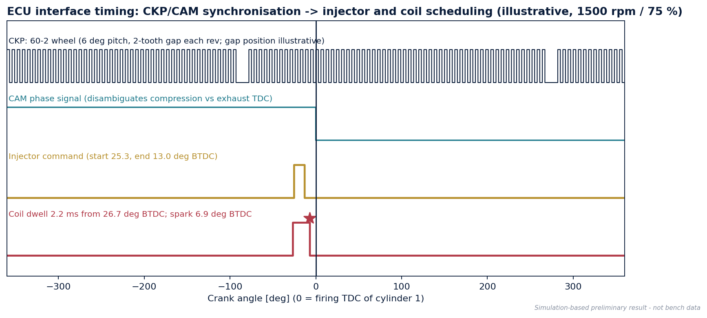
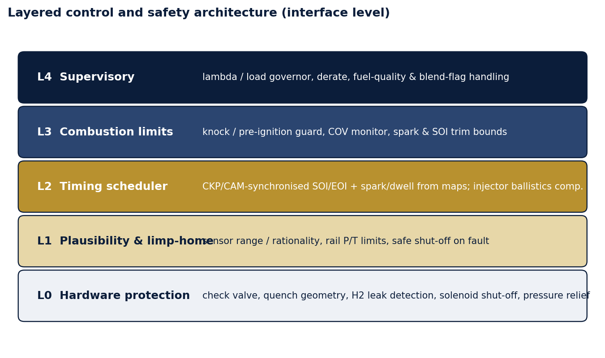
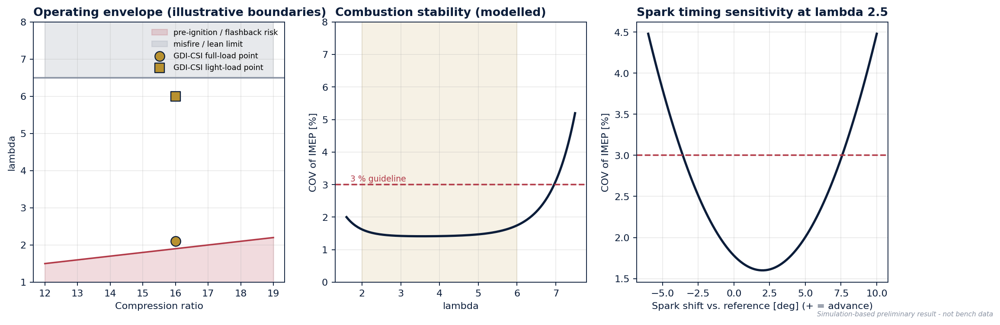
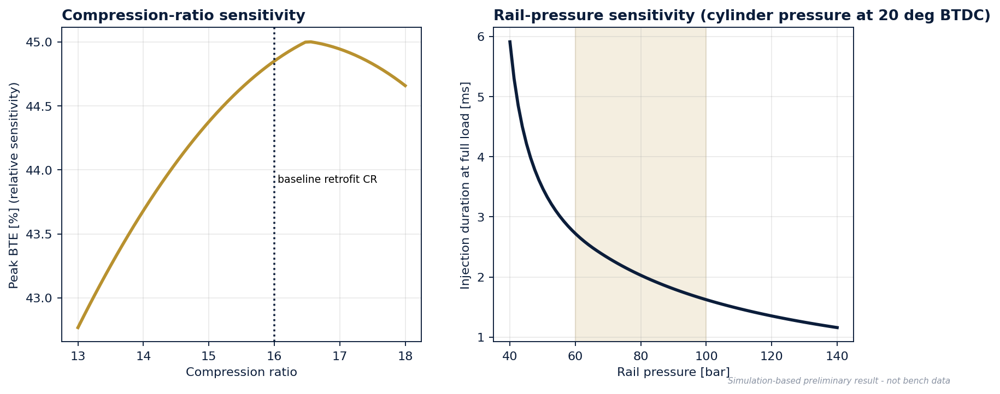

## 6. Repository layout

```
.
├── README.md
├── requirements.txt / requirements-dev.txt
├── pytest.ini
├── .github/workflows/ci.yml   tests + regenerate all figures on every push
├── tests/                    model sanity tests
├── data/                     CSV maps, performance curves, summary.json
├── docs/                     architecture, strategy, ECU interface, safety, validation, assumptions
├── results/figures/          18 generated plots
└── src/
    ├── model.py              reduced-order model (geometry, injector flow, maps)
    └── generate_results.py   regenerates every figure and CSV
```

Reproduce: `pip install -r requirements.txt && python src/generate_results.py`
Tests: `pip install -r requirements-dev.txt && pytest` (also run by GitHub Actions on every push and pull request)

## 7. Scope and next steps

* In scope: CI-to-GDI-CSI conversion for heavy commercial vehicles. SI (petrol) donors need different injector sizing and compression-ratio handling and are future work.
* Next: single-cylinder test-cell data, replacement of parametric maps with measured data, 3D CFD of mixing and flame propagation, ECU hardware-in-the-loop, durability of injector and head materials. See [`docs/VALIDATION_PLAN.md`](docs/VALIDATION_PLAN.md).

## Intellectual property

This repository intentionally does not disclose proprietary design details, fuel composition, blend ratios, hardware drawings or production calibration belonging to HERRSCHER. Values shown are simulation placeholders for methodology demonstration.

## Author

Arun Roshan A S - Automotive R&D | Powertrain & Combustion | Hydrogen ICE | ECU & Embedded Systems - HERRSCHER
